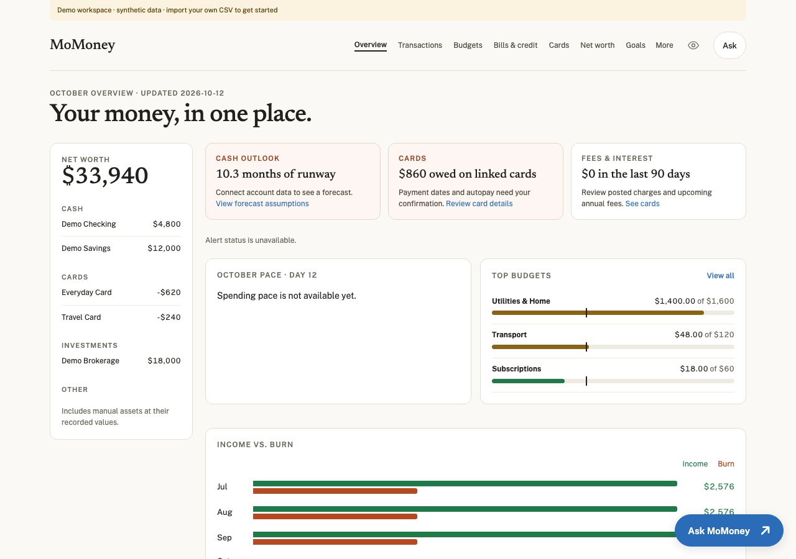

# MoMoney

A self-hosted personal finance dashboard you can fork and make your own. See your accounts, transactions, budgets, bills, cards and goals in one responsive interface.



Built with Next.js, React and TypeScript. MIT licensed. Single-user, USD-first, and useful without an AI key or bank connection.

## Try it locally

Requires Node.js 20.15+ and Python 3.10+.

```sh
git clone https://github.com/mohit-nontechnical/momoney-oss.git
cd momoney-oss
npm ci
npm run setup:demo
npm run dev
```

Open **http://127.0.0.1:3010**. The example workspace is entirely fictional and labelled as a demo. Local development binds only to loopback. You can edit categories, tags, splits, statement details and goals; changes stay in the ignored `.data/` directory.

## Use your own data

1. Export transactions from your financial app or bank and normalize the columns using [the CSV example](examples/transactions.csv).
2. Copy [the account configuration](examples/accounts.json) **outside this repository**. Enter your own as-of date, current balances, account types, card fees, goal and optional budgets. These are your inputs; balances are not inferred from transactions.
3. Import into a separate private directory:

```sh
npm run import:csv -- --csv /private/path/transactions.csv --config /private/path/accounts.json --out /private/path/momoney-data
```

4. Copy `.env.example` to `.env.local` and set `MOMONEY_DATA_DIR` to that absolute directory. Restart the app.

CSV columns: `date,payee,amount,category,account`. Dates use `YYYY-MM-DD`; amounts are USD decimal numbers, negative for expenses and positive for deposits. Account names must match the configuration. Use `Income` or `Business Income` for earnings. `Transfer`, `Credit Card Payments` and `Starting Balances` are excluded. Category spending is gross charges; refunds are not deducted or counted as income. Inspect your export's signs and classifications before importing.

Only claim `complete_all_accounts: true` and provide `coverage_start` when your export covers **all** listed accounts over the entire trailing 90 days. Otherwise card spending/fee-drag comparisons remain unavailable. The recent transaction view is capped at 500 rows; reaching the cap also disables those comparisons. Aggregate month totals include all imported rows. Sparse months can make averages misleading; import complete months for meaningful comparisons.

The importer refuses to overwrite existing data without `--replace`. Back up first. Reimports replace snapshot, analysis, receipts and history; saved app customizations and tasks remain. This release does **not** include automatic bank sync, an Actual Budget connector, receipt scanning or a writeback worker. Category edits change this app only unless you implement an adapter yourself.

## Host your own instance

```sh
cp .env.example .env.local
# Set APP_PASSWORD to a unique, strong password and MOMONEY_DATA_DIR.
npm run build
npm start
```

Sign in with username **owner** and your `APP_PASSWORD`. Production refuses dashboard access when the password is unset. The default server listens on loopback: place a TLS reverse proxy in front of it for remote access. Never serve HTTP Basic credentials over a public unencrypted HTTP connection. This is a single-owner app, not a multi-user financial service.

For a persistent server, mount/back up the private data directory. For Vercel, configure your **own private Blob store**, `BLOB_READ_WRITE_TOKEN`, `BLOB_PREFIX` and `APP_PASSWORD`, then upload your imported data with `node --env-file=.env.local scripts/upload-data.mjs`. Serverless deployments need Blob; local files are not durable there. Protect preview deployments as carefully as production and give them a separate data namespace. No hosting configuration or credentials are preconnected.

## Optional Ask

Set `OPENROUTER_API_KEY` and optionally `ASK_MODEL`. General questions send financial context and the conversation to OpenRouter and its selected model provider, and can incur usage fees. Without a key, local arithmetic answers for goals and annual card fees still work; general AI answers are unavailable. There is no background AI usage. Provider availability and pricing vary; check your selected provider before enabling it.

Answers use supplied facts and reject unsupported dollar figures, but this is not a guarantee of correctness. Review calculations and source data before making decisions. Card verdicts are imported notes, not instructions to cancel a card.

## Development

```sh
npm test
npm run build
```

Core screens: `/`, `/transactions`, `/budgets`, `/bills`, `/cards`. Supporting views include `/goals`, `/trends`, `/networth`, `/income`, `/household`, `/recommendations`, `/renewals`, `/scenarios`, `/trips`, `/ventures` and `/backlog`. Advanced views need corresponding snapshot fields; the minimal CSV importer leaves unsupported information unavailable.

The typed snapshot contract is in [`lib/types.ts`](lib/types.ts). Data access is in [`lib/data.ts`](lib/data.ts). Optional automation endpoints `/api/ingest`, `/api/edits` and `/api/summary` require their own scoped secrets. Browser routes use password authentication and same-origin mutation checks. See [SECURITY.md](SECURITY.md) and [CONTRIBUTING.md](CONTRIBUTING.md).

## Limits

- USD formatting and US category/date conventions; not yet localized.
- No automatic bank connection, money movement, trading or bill payment.
- Optional provider-generated answers can be wrong.
- Local files and Blob records do not provide distributed transactional writes; use one instance/owner and keep backups.
- No account recovery, roles or multi-tenant isolation. Password authentication needs a TLS/rate-limited front door for internet hosting.
- Demo screenshots are synthetic. Your financial files, passwords and API keys must never be committed.

## License

[MIT](LICENSE). Fork it, adapt it, and keep your financial data private. Dependencies retain their own licenses. Newsreader and Public Sans are loaded through Next's Google Fonts integration; their upstream font licenses apply.
